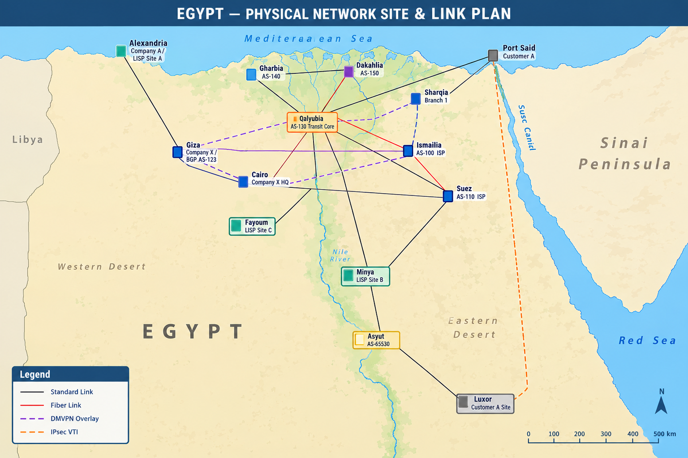
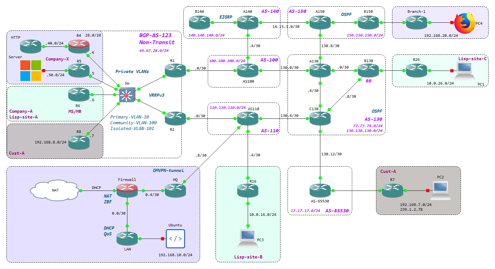

<div align="center">

# 🌐 ENCOR Enterprise Network Lab

### Full-scale multi-AS enterprise & service-provider lab built from scratch in GNS3, aligned with CCNP Enterprise (ENCOR)


**Designed and implemented by Mohamed Mahmoud Shehata**

</div>

---

## 📋 Project Overview

A full-scale enterprise and service-provider lab showcasing advanced routing, overlays, security, automation, QoS, and network assurance. It simulates a hybrid environment with multiple autonomous systems, enterprise customers, and secure overlays, and was built from scratch in **GNS3** to reflect architectures covered by the **CCNP Enterprise (ENCOR)** objectives.

### 🎯 Objectives
- Design and implement multi-AS enterprise routing
- Apply BGP traffic engineering techniques
- Deploy scalable WAN overlay technologies
- Secure the network infrastructure and control plane
- Automate repetitive network operations
- Monitor and analyze network performance and traffic flows

---

## 📑 Table of Contents
- [Network Views](#-network-views)
- [Quick Overview](#-quick-overview)
- [BGP & Routing Design](#-bgp--routing-design)
- [Overlay Technologies](#-overlay-technologies)
- [Automation](#-automation)
- [Quality of Service](#-quality-of-service)
- [NAT](#-nat)
- [Security](#-security)
- [Network Assurance](#-network-assurance)
- [Images Used](#-images-used)
- [Repository Structure](#-repository-structure)
- [Author](#-author)

---

## 📐 Network Views

### 🔹 Physical View
Campus-style layout showing the location of every site, router, switch, server and link.

<div align="center">



*Figure 1 – Physical view*

</div>

### 🔹 Logical Topology
Logical view showing the autonomous systems, IP addressing, routing protocols and overlays.

<div align="center">



*Figure 2 – Logical topology*

</div>

---

## ⚡ Quick Overview

| Area | Technologies |
|---|---|
| **Routing** | Multi-AS BGP, EIGRP, OSPF, route summarization |
| **Overlays** | DMVPN Phase 2, LISP, IPsec VTI |
| **Security** | Zone-Based Firewall, CoPP, NAT, Private VLANs |
| **QoS** | Policing, CBWFQ, DSCP marking, NBAR |
| **Automation** | Python (Netmiko), Jinja2, FastAPI |
| **Monitoring** | SNMP, NetFlow, SPAN/RSPAN, Syslog, IP SLA |

### Autonomous Systems & Domains

| Domain | Role | Protocol |
|---|---|---|
| **AS 123 (Company-X)** | Enterprise non-transit AS | BGP, OSPF |
| **AS 100 / AS 110** | Upstream providers | BGP |
| **AS 130** | Transit AS with route reflector | BGP, OSPF |
| **AS 140** | Customer AS | BGP, EIGRP |
| **AS 150** | Customer AS | BGP, OSPF |
| **AS 65530** | Customer AS (private) | BGP |

---

## 🔀 BGP & Routing Design

### AS 123: Enterprise Edge
- Non-transit autonomous system
- Outbound traffic via **R1** using **VRRPv3**
- VRRP object tracking integrated with **IP SLA**
- Inbound traffic influenced via **AS-path prepending** toward **R2**
- Resiliency, redundancy and deterministic traffic flow

### Private VLANs
Configured on the access switch (`SW`) to isolate client traffic while sharing infrastructure:
- **Primary VLAN 10**
- **Community VLAN 100:** Company-X
- **Isolated VLAN 101**

### BGP Autonomous Systems Overview

| AS | Function |
|---|---|
| **AS 123** | Non-transit enterprise AS with high availability (VRRPv3) |
| **AS 130** | Removes private AS, advertises `17.17.17.0/24`, sends only a default route to AS 65530 |
| **AS 140** | Advertises summary prefix `140.140.140.0/24` |
| **AS 150** | Advertises summary prefix `150.150.150.0/24` |
| **AS 65530** | Advertises summary prefix `17.17.17.0/24` |

<details>
<summary><b>🔸 AS 123: VRRP + IP SLA tracking</b></summary>

```
track 1 ip sla 1
 delay down 5 up 5
!
interface Ethernet0/0
 ip address 44.67.28.1 255.255.255.0
 vrrp 1 address-family ipv4
  priority 110
  track 1 decrement 40
  address 44.67.28.3 primary
  exit-vrrp
!
ip sla 1
 icmp-echo 100.100.100.1 source-ip 100.100.100.2
 frequency 10
ip sla schedule 1 life forever start-time now
```
</details>

<details>
<summary><b>🔸 AS 123: Non-transit BGP</b></summary>

```
router bgp 123
 bgp log-neighbor-changes
 network 44.67.28.0 mask 255.255.255.0
 neighbor 100.100.100.1 remote-as 100
 neighbor 100.100.100.1 route-map inbound-traffic-map out
 neighbor 100.100.100.1 filter-list 10 out
!
ip as-path access-list 10 permit ^$
```
</details>

<details>
<summary><b>🔸 AS 130: Remove private AS</b></summary>

```
router bgp 130
 bgp log-neighbor-changes
 neighbor 2.2.2.2 remote-as 130
 neighbor 2.2.2.2 update-source Loopback0
 neighbor 2.2.2.2 next-hop-self
 neighbor 130.130.130.2 remote-as 100
 neighbor 130.130.130.2 remove-private-as
 neighbor 130.130.130.10 remote-as 150
 neighbor 130.130.130.10 remove-private-as
```
</details>

<details>
<summary><b>🔸 AS 65530: Summary prefix</b></summary>

```
router bgp 65530
 bgp log-neighbor-changes
 network 17.17.17.0 mask 255.255.255.252
 aggregate-address 17.17.17.0 255.255.255.0 summary-only
 neighbor 130.130.130.13 remote-as 130
```
</details>

---

## 🔐 Overlay Technologies

### Company-X: DMVPN Phase 2
- **HQ** is the hub; **Branch** and **R5** are spokes
- **OSPF** is the overlay routing protocol (network type **broadcast**)
- mGRE tunnel in **Area 0**; HQ = **Area 10**, Branch = **Area 20**, R5 = **Area 50**
- Tunnel protected with IPsec

<details>
<summary><b>🔸 DMVPN hub configuration</b></summary>

```
crypto isakmp policy 100
 encr aes 192
 hash sha256
 authentication pre-share
 group 14
 lifetime 7200
crypto isakmp key <PRE-SHARED-KEY> address 0.0.0.0
!
crypto ipsec transform-set crypt_ts esp-aes 192 esp-sha256-hmac
 mode transport
!
crypto ipsec profile crypto-profile
 set transform-set crypt_ts
!
interface Tunnel10
 ip address 172.19.10.1 255.255.255.0
 no ip redirects
 ip mtu 1400
 ip nhrp authentication <NHRP-KEY>
 ip nhrp map multicast dynamic
 ip nhrp network-id 10
 ip tcp adjust-mss 1360
 ip ospf network broadcast
 ip ospf hello-interval 15
 ip ospf 1 area 0
 tunnel source Ethernet0/0
 tunnel mode gre multipoint
 tunnel key 10
 tunnel protection ipsec profile crypto-profile
```
</details>

### Company-A: LISP
- Advertises the prefixes behind **R16** and **R26**
- Runs on top of mGRE for privacy
- **R6** acts as **Map Server / Map Resolver**
- Separates endpoint identity from location for scalability

### Cust-A: IPsec VTI
- IPsec VTI tunnel between **R7** and **R8**
- Multicast carried through the tunnel using **PIM Sparse Mode** with a **static RP**

<details>
<summary><b>🔸 IPsec VTI configuration</b></summary>

```
crypto isakmp policy 100
 encr aes
 hash sha256
 authentication pre-share
 group 5
 lifetime 7200
crypto isakmp key <PRE-SHARED-KEY> address 44.67.28.8
!
crypto ipsec transform-set crypt-ts esp-aes 192 esp-sha-hmac
 mode transport
!
crypto ipsec profile crypto-profile
 set transform-set crypt-ts
!
interface Tunnel78
 ip address 172.17.78.1 255.255.255.252
 ip pim sparse-mode
 tunnel source Ethernet0/0
 tunnel mode ipsec ipv4
 tunnel destination 44.67.28.8
 tunnel protection ipsec profile crypto-profile
```
</details>

---

## 🤖 Automation

- Automated repetitive router configuration tasks (e.g. SNMP)
- **Netmiko** for device interaction
- **Jinja2** templates used with Netmiko to generate configurations
- Basic APIs built with **FastAPI** combined with Netmiko to push configs

<details>
<summary><b>🔸 Netmiko example</b></summary>

```python
from netmiko import ConnectHandler
from rich import print as rp
from Devices import Routers

for device in Routers.values():
    conn = ConnectHandler(**device)
    conn.enable()
    output = conn.send_command("show version", use_textfsm=True)
    rp(output)
```
</details>

---

## 🚦 Quality of Service

Applied on the **Company-X LAN router**:
- Social media traffic **policed to 250 kbps**
- Scavenger traffic (torrent) **dropped**
- Traffic destined to **R5** marked as **critical**, with **30% CBWFQ** bandwidth of the CIR

<details>
<summary><b>🔸 QoS configuration</b></summary>

```
class-map match-any Critical-traffic-class
 match access-group name critical-traffic-acl
class-map match-any Social-media-class
 match protocol twitter
 match protocol facebook
 match protocol instagram
class-map match-any Scavenger-traffic-class
 match protocol bittorrent
 match protocol netflix
!
policy-map Network-traffic-policy
 class Scavenger-traffic-class
  drop
 class Social-media-class
  set dscp af13
  police 250000 conform-action transmit exceed-action drop
 class Critical-traffic-class
  bandwidth percent 30
  set dscp af31
!
interface Ethernet0/0
 ip address 192.168.10.1 255.255.255.0
 ip nbar protocol-discovery
 ip flow ingress
 ip flow egress
 ip ospf 1 area 10
!
interface Ethernet0/1
 ip address 10.0.0.2 255.255.255.252
 ip ospf network point-to-point
 ip ospf 1 area 10
 service-policy output Network-traffic-policy
```
</details>

---

## 🌍 NAT

- The router labeled **HTTP** emulates a web server
- Static port forwarding on **R4** exposes the service at `http://44.67.28.4/`
- Reachable from **PC2** in Cust-A

```
ip nat inside source static tcp 192.168.40.100 80 44.67.28.4 80 extendable
```

---

## 🛡️ Security

- **Zone-Based Firewall** separating the LAN and Internet links
- **CoPP** on HQ, R5 and Branch-1
- **Private VLANs** on the access switch

<details>
<summary><b>🔸 Zone-Based Firewall</b></summary>

```
class-map type inspect match-any inside-internet-class
 match protocol tcp
 match protocol udp
 match protocol icmp
!
policy-map type inspect inside-internet-policy
 class type inspect inside-internet-class
  inspect
 class class-default
  drop
!
zone security Inside
zone security Internet
zone-pair security inside-internet-zone source Inside destination Internet
 service-policy type inspect inside-internet-policy
!
interface Ethernet0/0
 ip address 10.0.0.1 255.255.255.252
 ip nat inside
 ip virtual-reassembly in
 zone-member security Inside
 ip ospf network point-to-point
 ip ospf 1 area 10
!
interface Ethernet0/1
 ip address 10.0.0.5 255.255.255.252
 zone-member security Inside
 ip ospf network point-to-point
 ip ospf 1 area 10
```
</details>

<details>
<summary><b>🔸 CoPP</b></summary>

```
ip access-list extended Icmp-CoPP-acl
 permit icmp any any
ip access-list extended Management-CoPP-acl
 permit udp host 192.168.50.100 any eq snmp
 permit tcp any any eq 22
ip access-list extended Routing-CoPP-acl
 permit ospf any host 224.0.0.6
!
control-plane
 service-policy input CoPP-Policy
```
</details>

---

## 📊 Network Assurance

- **SNMP** on all Company-X routers, monitored from the server
- **NetFlow** on the LAN, R5 and Branch-1 routers to monitor traffic types
- **IP SLA** for VRRP object tracking

<details>
<summary><b>🔸 SNMP</b></summary>

```
ip access-list standard snmp_acl
 permit 192.168.50.100
!
snmp-server community <COMMUNITY> RO snmp_acl
snmp-server system-shutdown
snmp-server enable traps config
snmp-server host 192.168.50.100 version 2c <COMMUNITY>
```
</details>

---

## 🧰 Images Used

| Component | Image |
|---|---|
| Routers | `i86bi-linux-l3-adventerprisek9-ms.155-2.T.bin` |
| Switches | `i86bi_linux_l2-adventerprise-ms.high_iron_20170202.bin` |
| Server | Windows Server 2016 (evaluation ISO) |
| Ubuntu | Ubuntu Desktop VM |
| PCs | GNS3 webterm Docker |

---

## 📁 Repository Structure

```
ENCOR-Enterprise-Network-Lab/
├── 📄 README.md
├── 🖼️ Physical_View.png
├── 🖼️ Logical_View.png
├── 📦 ENCORv2.gns3
└── 📂 configs/
```

---

## 👤 Author

**Mohamed Mahmoud Shehata**
Network Engineer | CCNA · CCNP Enterprise · Microsoft Azure

<div align="center">

⭐ If you found this project useful, consider giving it a star!

</div>
